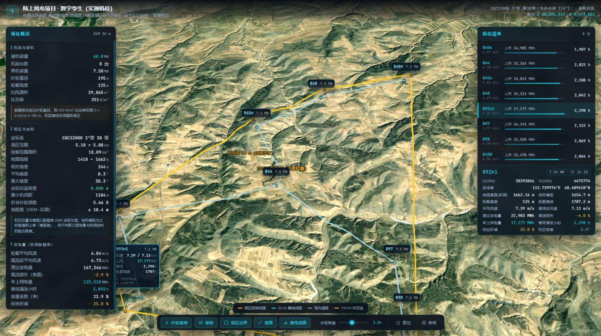

# 凉城 60 MW 陆上风电项目 · 数字孪生（实测机位版）

基于实测工程资料的风电场三维数字孪生系统。场址位于内蒙古自治区乌兰察布市凉城县六苏木镇，装机 **8 × 7.5 MW = 60 MW**，8 台机位的位置、高程、风速与发电量**全部取自项目数据表**，不使用假设值。



> CesiumJS 1.118（已本地化）· 原生 JS，无构建工具 · Python 3 做数据流水线
> 机位按 **CGCS2000 3°带 38 带** 实测坐标建模，投影反算往返残差 0.0000 m

---

## 1. 快速开始

**方式一（推荐）**：双击 `启动预览.bat`，浏览器自动打开 `http://127.0.0.1:8123/index.html`。

**方式二**：任意静态服务器托管本目录，例如

```bash
python -m http.server 8123
```

> 必须通过 HTTP 访问，不要直接双击 `index.html`。卫星影像为跨域瓦片，`file://` 协议下会被浏览器拦截。

三维引擎 CesiumJS 1.118 已本地化到 `libs/cesium/`；卫星影像来自 Esri 公开服务，首次加载需联网。

---

## 2. 坐标基准（本版核心变更）

数据表给出的是 **CGCS2000 3° 带第 38 带（中央经线 114°E）高斯投影坐标**，不是经纬度。场景渲染必须用 WGS-84 经纬度，因此先做严密投影反算。

### 2.1 坐标系判定

| 项 | 值 |
|---|---|
| 参考椭球 | CGCS2000，a = 6 378 137 m，1/f = 298.257 222 101 |
| 投影 | 高斯-克吕格，3° 带，k₀ = 1 |
| 带号 | 38（由东坐标前两位判定） |
| 中央子午线 | 114°E |
| 东伪偏移 | 500 000 m |

> **注意**：数据表列名为「X（2000坐标系）/ Y（2000坐标系）」，但 X 列为 8 位东坐标（含带号）、Y 列为北坐标，与测量习惯「X 为北」相反。程序按**数值特征**判定而非按列名判定，判定结果在导入日志中打印。

### 2.2 投影反算

由 `src/coord2000.py` 完成。底点纬度用子午线弧长数值积分 + 牛顿迭代求解，不用级数系数，避免符号错位这类隐蔽错误：

- 子午线弧长校验：M(90°) = 10 001 965.729 m，与理论值逐位一致
- **往返校验残差：0.0000 m**（8 台机位全部通过，容差 0.02 m）

### 2.3 场景原点

| 项 | 值 |
|---|---|
| 原点定义 | 8 台机位重心 |
| E(2000) | 38 395 018.875 |
| N(2000) | 4 477 802.375 |
| 经度（WGS-84） | 112.76287911°E |
| 纬度（WGS-84） | 40.42812353°N |
| 经度（GCJ-02） | 112.76971643°E |
| 纬度（GCJ-02） | 40.42933396°N |

场景内所有实体以局部 ENU 平面为工作坐标（x = E − 原点 E，y = N − 原点 N，单位 m），转经纬度时采用椭球曲率半径法；5 km 范围内与严格大地线解算的差异小于 0.3 m。

### 2.4 交叉验证（重要）

把反算出的经纬度交给 ASTER GDEM 取高程，与数据表给出的 Z 逐台比对：

| 机位 | 数据表 Z (m) | DEM 模型 (m) | 差值 | 机位坡度 |
|---|---|---|---|---|
| B40n | 1484.47 | 1485.0 | +0.5 | 4.2° |
| B44 | 1575.70 | 1581.4 | +5.7 | 3.3° |
| B45n | 1540.00 | 1529.6 | −10.4 | 5.4° |
| B48 | 1514.13 | 1512.4 | −1.7 | 4.6° |
| B92n1 | 1662.16 | 1654.7 | −7.5 | 2.9° |
| B97 | 1607.58 | 1608.8 | +1.2 | 2.4° |
| B98 | 1604.44 | 1599.9 | −4.5 | 1.5° |
| B100 | 1577.34 | 1570.3 | −7.0 | 4.1° |

最大差 10.4 m、平均 4.8 m，量级与 ASTER 30 m 数据在丘陵区的自身误差相当。**若坐标换算有错（哪怕只差一个带号），高程不可能对得上**——这是坐标链路正确的最直接证据。

---

## 3. 机位实测数据

| 机位 | E(2000) | N(2000) | 经度 | 纬度 | 地面高程 m | 平均风速 m/s | 尾流后 m/s | 理论 MWh | 尾流 % | 上网 MWh | 等效 h |
|---|---|---|---|---|---|---|---|---|---|---|---|
| B40n | 38397196 | 4480710 | 112.78805923 | 40.45457397 | 1484.47 | 6.59 | 6.51 | 19873.2 | −1.9 | 14904.9 | 1987.3 |
| B44 | 38394755 | 4477812 | 112.75976864 | 40.42817687 | 1575.70 | 6.70 | 6.59 | 20217.5 | −2.8 | 15163.2 | 2021.8 |
| B45n | 38394357 | 4479253 | 112.75484023 | 40.44110035 | 1540.00 | 6.81 | 6.74 | 21083.6 | −1.8 | 15812.7 | 2108.4 |
| B48 | 38395523 | 4480132 | 112.76843579 | 40.44916155 | 1514.13 | 6.67 | 6.62 | 20416.7 | −1.4 | 15312.5 | 2041.7 |
| B92n1 | 38393046 | 4475774 | 112.73997639 | 40.40961024 | 1662.16 | 7.29 | 7.13 | 22902.6 | −4.0 | 17177.0 | 2290.3 |
| B97 | 38396442 | 4476340 | 112.77988383 | 40.41513526 | 1607.58 | 6.97 | 6.85 | 21521.6 | −3.2 | 16141.2 | 2152.2 |
| B98 | 38396420 | 4475236 | 112.77980424 | 40.40519265 | 1604.44 | 6.78 | 6.68 | 20693.9 | −2.6 | 15520.5 | 2069.4 |
| B100 | 38392412 | 4477162 | 112.73227442 | 40.42202525 | 1577.34 | 6.88 | 6.69 | 20637.2 | −5.3 | 15477.9 | 2063.7 |
| **合计/平均** | — | — | — | — | — | **6.84** | **6.73** | **167 346.4** | **−2.9** | **125 509.8** | **2 091.8** |

### 3.1 汇总指标

| 指标 | 数值 |
|---|---|
| 装机容量 | 60.0 MW（8 × 7.5 MW） |
| 场区控制范围 | 5.18 × 5.88 km，面积 18.89 km²（机位凸包外扩 250 m） |
| 装机密度 | 3.18 MW/km² |
| 理论发电量 | 167.3 GWh |
| 年上网电量 | 125.5 GWh |
| 等效满发小时 | 2 091.8 h |
| 容量系数（净） | 23.9 % |
| 综合折减 | 25.0 % |

### 3.2 数据表内部口径提示（须复核）

数据表中 **8 台机位的「上网电量 ÷ 理论发电量」全部等于 0.7500**，即统一乘了 25% 折减；而「尾流损失」列只有 −1.4 ~ −5.3%。两者不是同一口径：折减 25% 里包含了尾流、控制、电气线损、可用率、叶片污损等全部因素。

本系统按原表数值呈现，不做二次加工。**建议在微观选址报告中把折减构成拆分清楚**，否则「尾流损失只有 2.9% 而折减却有 25%」这一组数字在评审时会被追问。

### 3.3 机型参数与推断项

| 参数 | 取值 | 来源 |
|---|---|---|
| 单机容量 | 7 500 kW | 由「上网电量 ÷ 等效小时」逐台反算，8 台一致 |
| 轮毂高度 | 125 m | 数据表 |
| 叶轮直径 | **220 m** | 风机参数表 |
| 扫风面积 | 29 865 m² | 由叶轮直径计算 |
| 比功率 | 251 W/m² | 由容量与扫风面积计算 |
| 额定转速 | 8.4 r/min | 三维动画基准值，非数据表值 |
| 主导风向 | 315°（NW） | 数据表未给出，沿用项目区主导风向 |

> **叶轮直径是唯一需要确认的参数。** 机型确定后修改 `src/import_windfarm.py` 顶部的 `ROTOR_D` 并重跑流水线即可，间距倍数、扫风面积、比功率会自动更新。

---

## 4. 三维场景内容

| 图层 | 内容 |
|---|---|
| 地形 | ASTER GDEM v3 分级融合：±2.4 km / 40 m，±12 km / 300 m，±14 km / 1750 m |
| 影像 | Esri World Imagery，19 级 |
| 风机 | 8 台，塔筒 + 机舱 + 轮毂 + 三叶片（4 段变弦长，按叶长比例生成） |
| 机位看板 | 每台风机上方一块 HTML 看板：编号、容量、风速、上网电量、等效小时、轮毂海拔、**2000 坐标** |
| 场区边界 | 机位凸包外扩 250 m 的闭合多边形，随地形起伏 |
| 道路 | 以 8 台机位 + 升压站为节点做最小生成树 |
| **35 kV 集电线路** | **73 基杆塔（实测塔位）+ 24.51 km 导线**，按塔号规则成链（AB / A / A3 / B / B7 / B10），三相导线带抛物线弧垂 |
| 升压站 | 机位重心附近 62 × 46 m 围墙，示意位置 |
| 测风塔 | 125 m，位置示意 |

> 集电线路杆塔取自 `风场数据/集电线路.xlsx`：73 基塔位坐标（CGCS2000 3° 带 38 带），
> 线路总长 24.51 km，档距 155～630 m（均 350 m）。塔型按工程通例判定（链首末 / 转角 >15° /
> 支线分歧 / 耐张段 >2 km → 耐张塔），共耐张 30 基、直线 43 基，属**推断值**，接入施工图后应据实修正。

### 4.0 杆塔模型：图纸级 G081-J1 角钢塔

杆塔几何来自图纸 **G081-J1 单回路 35 kV 角钢塔**（塔型 J1YH-2024-0212-L0202），由 `js/tower-j1.js`
参数化生成，**不是**简化体块：

| 项目 | 数值 | 来源 |
|---|---|---|
| 全高 | 30.70 m | 图纸 |
| 呼高（地面→下横担） | 24.00 m | 图纸 |
| 根开 / 顶宽 | 4.372 m / 0.400 m | 图纸 |
| 下横担 | ±2.550 m @ 24.00 m（双侧，挂边相） | 图纸 |
| 上横担 | +2.000 m @ 27.60 m（单侧，挂中相） | 图纸 |
| 构件 | 275 个：主材 L100×10→L56×5 变规格、斜材 L50×4、水平材/横隔 L45×4、横担 L80×6 | 材料汇总表 |
| 三角形 | 5788（含 3 处悬垂绝缘子串的简化体） | 生成值 |
| 绝缘子 | 3 片 XWP-70 悬垂串，按 1.6 倍显示放大 | 图纸 |

**实现方式**：`tower-j1.js` 输出局部坐标的 `positions / normals / indices`，
`app.js` 为每个塔位构造一个 `Cesium.GeometryInstance`，73 个实例合并为一个 `Primitive`
（`PerInstanceColorAppearance` + 法线光照）。三角面 5788×73 ≈ 42 万，一次 draw call。

> 为什么不用 glTF：实测 Cesium 的 `Model` 在 SwiftShader 软件渲染下不绘制（`ready`、位置、
> 包围球均正确却不可见），无法在无头环境验收。改用 Primitive 后各环境一致。
> `libs/models/*.glb` 与 `src/make_tower_glb.py` 保留作备用方案。

杆塔与风机共用同一「模型放大」倍率（1.0–5.0，默认 2.0），倍率变化时重建实例矩阵。

### 4.1 场景与机位标识

界面分四区：顶栏（项目身份 + 三个页签 + 演示/场景控制/全屏/复位）、中央三维场景、左侧信息面板、底部控制台。选中机位时右侧滑出详情抽屉。

**布局为工业大屏式三侧贴边**：顶栏 54 px 通栏，左列 322 px、右列 322 px 分别贴满左右边（含底部行），底部控制台 236 px 横贯中间列，三块面板之间以及与场景之间**无间隙**。中间留给三维场景，画布尺寸即面板之间的实际可用区。

**视觉基底**：近黑底（#04070b）+ 面板深蓝黑（#070d14）；每张卡片左上角是切角编号块（`clip-path` 斜切，青→蓝渐变），标题为白色 12 px，右侧跟英文副标题与状态标签（黄 / 绿 / 紫）。主色蓝（#2f9dff）绿（#2fe0a0），辅助黄（#fbbf24）、紫（#a78bfa）、红（#ff6b6b）只用于状态与告警。卡片之间用 1 px 半透明青边与 8 px 间距分隔，不用大圆角与投影。

**左列**随页签切换三套卡片：场址总览（概况 / 条件 / 机组 / 间距 + 占位）、机位分析（清单 / 间距 + 占位）、地形与工程（地形 / 核对 + 占位）。**右列**是常驻的机位详情，未选中时显示空态骨架，选中后填充身份、四指标、风况发电、工程坐标四张卡片。两列末尾都有一张虚线**占位卡**，撑满剩余高度，供后续扩展。

**底部控制台**分四栏：图层（5 项 + 颜色图例）、场景（叶轮旋转 / 转速 / 模型放大 / 主导风向）、机位年上网电量条形图、占位列。窄屏（≤1500 px）自动降为三栏（隐去占位列）。

**底图源在顶栏**：导航右侧的「卫星影像 ▾」按钮，点开是 8 个源的两列网格，选中项高亮，点外部或 `Esc` 关闭。

**机位标签三态**：

| 状态 | 触发 | 表现 |
|---|---|---|
| 全场浏览 | 默认 / 「场址总览」页签 | 仅显示编号 chip |
| 机位分析 | 切到「机位分析」页签 | 编号 + 上网电量两行 chip |
| 单机详情 | 进入单机视角 | 选中机展开数据卡（含 2000 坐标），其余 chip 淡化 |

标签在屏幕内自动避让，安全区按面板与抽屉的实际宽度动态计算；数据卡贴到顶栏下方时自动隐藏引线。

**相机**：全场 / 顶视 / 斜视三个预设均按当前视口与场区真实范围**迭代求解取景距离与视点偏移**（`fitCamera()`），机位数量或屏幕尺寸变化后仍然成立，不写死相机参数。

### 4.2 底图源（可切换）

底图不再写死，工具栏「底图」按钮下拉切换，分「影像」「地形」两组，选择写入 `localStorage`，下次打开沿用。

| 分组 | 底图 | 服务 | 最高层级 | 分辨率 | 说明 |
|---|---|---|---|---|---|
| 影像 | 卫星影像（默认） | Esri World Imagery | 19 | 0.3–0.6 m | 场区判断用，成像时间不明 |
| 影像 | **卫星影像 + 中文注记** | 天地图 img + cia | 18 | 0.5–2 m | 中文地名（西太平寨、杨树沟等），汇报首选 |
| 影像 | 卫星影像 + 英文注记 | Esri Imagery + Reference | 19 | 0.3–0.6 m | 注记为英文/拼音，备用 |
| 影像 | Sentinel-2 无云合成 | EOX，2020 年（CC BY-NC-SA 4.0） | 16 | 10 m | 色调均匀、无云，适合看植被与地类 |
| 地形 | **地形图 · 天地图** | 天地图 ter + cta | 18 | 中文等高线与地名 | 判读坡度与沟谷，中文注记 |
| 地形 | 晕渲地貌 | Esri World Shaded Relief | 13 | 30 m 晕渲 | 突出地形起伏，工程要素对比度高 |
| 地形 | 地形图 · Esri | Esri World Topographic | 13 | ≤13 级 | 含等高线注记与国省道；**场区尺度空白，县域尺度可用** |
| 地形 | 街道图 · Esri | Esri World Street Map | 13 | ≤13 级 | 同上，县域尺度可用 |

**天地图密钥走两级配置**：`js/config.js`（入库，默认空）与 `js/config.local.js`（**不入库**，本地私密）。需要启用时把前者复制为后者再填 tk：

```bash
cp js/config.js js/config.local.js
# 编辑 config.local.js：window.APP_CONFIG.tiandituKey = '你的 tk';
```

密钥为「浏览器端」类型，服务端 curl 直连会返回 `301012 权限类型错误`，必须在网页内请求；这也是本仓库不在代码中写死 tk 的原因。留空时天地图两项自动置灰，其余 6 个源不受影响。


实现要点：

1. **层级上限按源单独设置**。Esri 地形图/街道图/晕渲在本区域 13 级以上返回「Map data not yet available」占位图，若沿用 19 级会在放大后看到白底提示文字，故逐源限定 `maximumLevel`。
2. **瓦片坐标系必须核对**。天地图为 CGCS2000 地理坐标、Web 墨卡托切片，与场景基准一致，可直接叠加；Esri 与 EOX 同为 Web 墨卡托。**高德/腾讯瓦片是 GCJ-02**，与 WGS-84 存在约 580 m 系统偏移（本场址实测 −579 m / −134 m），直接叠加会让 8 台风机整体错位，故未采用。
3. **注记层单独处理**。天地图 `cia`/`cta` 为带 `tRNS` 透明通道的调色板 PNG，作为独立图层叠在底图之上；Esri Reference 同理。切源时底图与注记层成对移除，连续切换 6 次后图层数始终为 1（无天地图源）或 2（有注记源），无残留。
4. **失败不静默**。切换后 8 s 内若有 ≥4 个瓦片报错，自动回退到卫星影像并弹出提示。
5. **密钥安全**。`tk` 随前端代码下发，任何人打开页面均可看到。已在天地图控制台按域名/Referer 配置白名单者为佳；若后续部署到公网，务必在控制台限制域名并关注配额，或改为自建代理转发（代理侧持有 tk），用完再撤。

> 天地图影像在个别地块有明显拼接色块（同一图幅不同时相），属源数据特性，不是渲染问题。


---

## 5. 数据流水线

```
风场数据/风电场.xlsx                  风场数据/集电线路.xlsx
        │  src/import_windfarm.py           │  src/import_gridline.py
        ▼  （机位/电量/边界）                 ▼  （塔位/塔型/线路拓扑）
   data/site.json                     data/gridline.json
        └──────────────┬───────────────────┘
                       │  src/fetch_dem.py      分级 DEM + 塔位高程点采样（带缓存续采）
                       ▼
                  data/dem.json
                       │  src/build_js_data.py   地形统计 + 机位/杆塔 DEM 高程 + 打包
                       ▼
                  data/site-data.js  ──►  js/app.js

   src/make_tower_glb.py  生成塔型参数 data/tower-types.json（塔型统计与备用 glb；
                          当前前端杆塔几何取自 js/tower-j1.js，不用该文件）
```

### 重建命令

```bash
python src/import_windfarm.py    # 机位与电量（读 xlsx，约 1 s）
python src/import_gridline.py    # 集电线路杆塔（读 xlsx，约 1 s）
python src/make_tower_glb.py     # 塔型参数（含备用 glb，约 1 s）
python src/fetch_dem.py          # 采集 DEM + 塔位高程（需联网，约 6 min，中断可续采）
python src/build_js_data.py      # 打包前端数据
```

### 单一数据源约定

- **前端不硬编码任何业务数字**：机位、高程、电量、机型、分级融合权重、基准高程、**塔型几何参数（横担/挂点/根开）**全部从 `site-data.js` 读。
- **分级融合权重**由 `build_js_data.py` 写入数据文件（`terrainBlend`），`app.js` 直接读取，两边不会漂移。
- **地形高度函数**在 Python 与 JS 中各实现一份，公式逐行对应；机位与杆塔的 DEM 高程由 Python 算好后写盘，前端只读不算。

---

## 6. 目录结构

```
数字孪生/
├── index.html                 主页面（含全部样式）
├── js/app.js                  三维场景逻辑（地形、风机、杆塔、看板、底图源、交互）
├── js/tower-j1.js             G081-J1 角钢塔几何生成（图纸参数化，输出 Cesium 顶点数据）
├── tower-j1-35kv.html         J1 塔单体模型预览页（Three.js，原始成果，供核对）
├── tower-35kv-3d.html         35kV 塔早期单体预览页（保留）
├── js/config.js               前端配置（入库，tk 留空）
├── js/config.local.js         本地私密配置（不入库，填 tk）
├── data/
│   ├── site.json              机位与电量（实测数据，由 import_windfarm.py 生成）
│   ├── gridline.json          集电线路杆塔（塔位/塔型/拓扑，由 import_gridline.py 生成）
│   ├── tower-types.json       塔型几何参数（横担/挂点/根开，由 make_tower_glb.py 生成）
│   ├── dem.json               分级 DEM 网格 + 塔位高程
│   ├── dem_cache.json         DEM 采集缓存（可删，删后重采）
│   ├── dem_points_cache.json  塔位高程点采样缓存
│   └── site-data.js           前端数据包（由 build_js_data.py 生成）
├── 风场数据/风电场.xlsx        机位原始数据表
├── 风场数据/集电线路.xlsx      杆塔塔位坐标表
├── libs/cesium/               本地化 CesiumJS 1.118
├── libs/models/               备用杆塔 glb（当前用 J1 图纸几何，见 README §4.0）
├── src/
│   ├── coord2000.py           CGCS2000 高斯投影 ↔ 经纬度（含自检）
│   ├── coord_transform.py     GCJ-02 ↔ WGS-84（仅用于记录火星坐标对照值）
│   ├── import_windfarm.py     xlsx → site.json
│   ├── import_gridline.py     集电线路 xlsx → gridline.json
│   ├── make_tower_glb.py      塔型参数 + 备用 glb → tower-types.json
│   ├── fetch_dem.py           DEM 采集 + 塔位高程（读 site.json / gridline.json）
│   ├── build_js_data.py       DEM + site + gridline → site-data.js
│   └── site_optimizer.py      【已停用】模板法机位布置，机位改为实测后不再入流水线
├── docs/
│   ├── UI_REDESIGN_AUDIT.md   UI 重构前审查报告
│   └── UI_REDESIGN_CHANGELOG.md  重构变更记录与验收结果
├── 预览/                      场景截图（ui/ 为界面验收图，底图/ 为各底图源样张）
├── 启动预览.bat
└── README.md
```

---

## 7. 操作说明

### 7.1 日常浏览

| 操作 | 效果 |
|---|---|
| 单击场景中的风机 | 选中并打开右侧详情抽屉（**不移动相机**） |
| 双击场景中的风机 | 选中并进入单机视角 |
| 单击「机位分析」清单行 | 选中并定位到该机 |
| 单击场景空白处 | 取消选中 |
| 顶栏「卫星影像 ▾」 | 8 个底图源，两列网格，单击即切换 |
| 底部控制台「模型放大」 | 风机模型显示放大 1.0–5.0 倍（步进 0.1，默认 2.0），**仅影响视觉**，不改坐标与高程 |
| 底部控制台「图层」 | 风机模型 / 机位编号 / 场区控制范围 / 场内道路 / 35 kV 杆塔与导线 |
| 底部控制台「场景」 | 叶轮旋转开关、叶轮转速 0.2–2.0× |
| 底部「全场 / 顶视 / 斜视」 | 切换相机预设，自动适配当前窗口尺寸 |
| 左列右上 `‹` | 收起左栏，屏幕左缘出现青色竖条，点击恢复 |
| 右列右上 `›` | 收起右栏，屏幕右缘出现青色竖条，点击恢复 |
| 底部控制台右侧 `⌃` | 收起为 34 px 细条，只保留标题与视角预设 |
| 快捷键 | `R` 复位、`F` 全屏、`L` 收起/展开左面板、`C` 收起/展开控制台、`Esc` 退出演示→取消选中→展开左面板 |

### 7.2 演示模式（业主汇报）

点顶栏「演示模式」进入，界面收起两侧面板，仅保留项目名、场景控制条与左下核心指标。

| 场景 | 内容 |
|---|---|
| 1 项目总览 | 全场 8 台机位与场址范围 |
| 2 场址与地形 | 低角度观察地形起伏与场址空间关系 |
| 3 机位分布 | 顶视查看机位相对位置与间距 |
| 4 典型机位 | 单机视角：地面高程、轮毂海拔与发电指标 |
| 5 回到全场 | 结束展示，恢复全场视角 |

`←` / `→` 或控制条按钮切换场景，`Esc` 或「退出演示」返回普通浏览。演示模式不做自动播放，不强制等待动画。

### 7.3 其它

- **底图源**：8 个源按「影像 / 地形」分两行排布，选择写入 `localStorage`，下次打开沿用；天地图需自备 tk（见 §4.2）。
- **面板布局**：左列、右列、底部控制台三块均可收起，收起时画布扩展到整个中间区域并自动 `resize`；收起状态不写入本地，刷新后恢复默认。
- **布局实现**：`body` 用 CSS Grid（`322px | 1fr | 322px` × `54px | 1fr | 236px`），三块面板的显隐靠 `body.lh-off / rh-off / dh-off` 改 CSS 变量，不用绝对定位换算。
- **风向**：全部机组按 315°（NW）统一偏航。
- **加载提示**：瓦片未加载完时底坞显示「影像加载中…」，此时场景中的明暗色块属正常现象。

---

## 8. 间距校核

| 项 | 数值 |
|---|---|
| 最小机间距 | **1 104 m**（B97 – B98） |
| 折合叶轮倍数 | **5.02 D**（D = 220 m） |
| 次小间距 | 1 460 m（B45n – B48）= 7.49 D |
| 最大间距 | 6 449 m |

按常规要求（主风向 5–8 D、横风向 3–5 D），本场最小 5.66 D 处于**下限附近**，可接受但无裕度。B97 与 B98 几乎正南北向排列，若主导风向为 NW，则该对机组存在部分尾流叠加，与数据表中 B97（−3.2%）、B98（−2.6%）的尾流值量级一致。

---

## 9. 已知限制

1. **地形精度**：ASTER GDEM 30 m 在近景（< 300 m）细节不足；机位高程以数据表 Z 为准，地形模型与之最大差 10.4 m。施工阶段须以实测地形图或无人机倾斜摄影替换。
2. **叶轮直径为推断值**：见 §3.3，须由机型资料确认。
3. **升压站、测风塔位置为示意**：数据表未给出，接入系统方案与测风塔坐标确定后修正。
4. **无阴影**：CesiumJS 的 Entity 不参与地形阴影投射，风机在地面没有投影。
5. **叶片为简化几何**：4 段变弦长 box，未反映翼型扭转与预弯；塔筒为等壁厚锥筒。
6. **影像时效**：Esri World Imagery 在该区域的成像时间未知，场区实际地类须以现场踏勘与国土「三调」数据核实。
7. **合规专题未做**：生态红线、基本草原、文物、军事设施、机场净空等避让核查不在本系统范围。

---

## 10. 后续可扩展方向

- 接入机位实测机型功率曲线，替换当前的容量反算口径
- 按数据表折减构成拆分（尾流 / 控制 / 电气 / 可用率），逐项复核
- 接入风资源图谱，生成风功率密度分布面
- 尾流可视化（按风向动态显示尾流锥）
- 施工进度模拟（基础浇筑 → 吊装 → 并网时间轴）
- 替换为实测 DOM + DEM 与实景三维模型（3D Tiles）


## 开发与校验

安装数据处理依赖：`python -m pip install -r requirements.txt`。

统一入口：`python src/run_pipeline.py`（包括联网采集）；已有 JSON 时使用 `python src/run_pipeline.py --offline` 仅重建前端数据。脚本路径以项目目录为基准，可从其他工作目录调用绝对路径。

回归检查：`python -m unittest discover -s tests -v`，跨语言地形一致性检查需要 Node.js。前端地形计算独立于 `js/terrain.js`，保持原有融合算法。

DEM 每批进度保存到 `data/dem_*_progress.json`，签名匹配时自动恢复；输出和缓存通过临时文件原子替换。旧模板脚本默认输出 `data/scenarios/template-site.json`，禁止覆盖正式 `data/site.json`。
